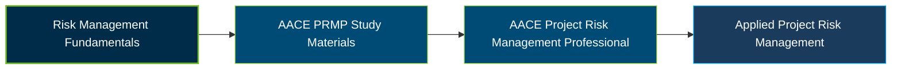

# AACE International PRMP Certification Exam Guide

 

A dedicated study guide and technical reference repository for candidates preparing for the **AACE International Project Risk Management Professional (PRMP) Certification Exam**, covering risk planning, risk assessment, response strategies, risk control, and professional communication.

---

## Exam Overview

The AACE International Project Risk Management Professional (PRMP) certification validates the knowledge and skills required to establish, implement, and communicate effective risk management plans aligned with project, program, and portfolio objectives.

- **Exam Format**: Computer-based examination with multiple-choice and scenario-based questions, plus a written memo assignment.
- **Target Audience**: Project risk managers, cost engineers, project controls professionals, and practitioners responsible for project, program, or portfolio risk.
- **Prerequisites**: Candidates must meet AACE's current education and industry-experience eligibility requirements. Review the official certification information before applying.

---

## Core Exam Domains & Knowledge Areas

### 1. Supporting Skills and Knowledge

- Apply cost engineering, cost estimating, and planning and scheduling concepts relevant to risk management.
- Understand procurement, contracts, earned value, and other functional disciplines that influence project risk.
- Apply statistics, probability, and related analytical concepts to project decisions.

### 2. Communication Competency

- Interpret a risk-management scenario and identify the issue requiring a professional response.
- Organize a memo with a clear purpose, proposed solution, supporting details, and closing statement.
- Communicate risk implications and recommendations clearly to project stakeholders.

### 3. Overall Risk Management Terminology and Concepts

- Understand risk-management terminology, principles, objectives, and the relationship between uncertainty and project outcomes.
- Apply probability, statistics, and risk concepts when evaluating potential impacts.
- Understand risk management within AACE's Total Cost Management (TCM) Framework.

### 4. Risk Management Skills and Knowledge

- Establish risk-management objectives and develop a risk management plan.
- Identify risks and perform qualitative and quantitative risk analysis, including cost and schedule risk considerations.
- Plan and implement risk responses, monitor risk performance, communicate results, and update project plans.

---

## Certification Path

The following is a suggested preparation progression, not an official prerequisite or mandatory certification pathway.

---

## Recommended Practice & Study Resources

Prepare using AACE's official certification guidance, recommended study materials, and practical application of project risk-management concepts.

- **CertsGate**: Visit the [AACE International PRMP certification preparation page](https://certsgate.com/exams/aace-international/prmp) for supplementary study materials and practice questions to review project risk-management concepts.
- **AACE Recommended Practice 121R-21**: Review [Required Skills and Knowledge of Project Risk Management](https://www-embed.pathlms.com/aace/courses/2928/documents/59460) to reinforce risk planning, identification, analysis, response, monitoring, and control within the TCM Framework.
